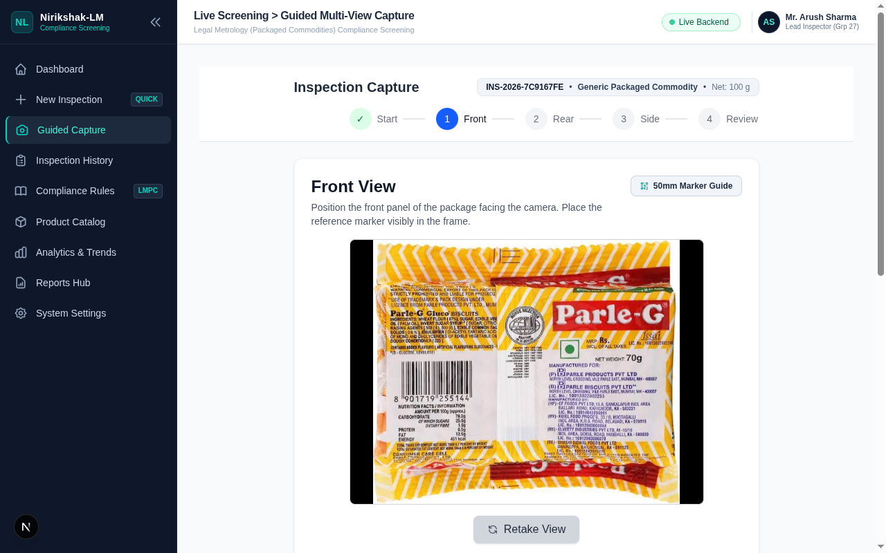
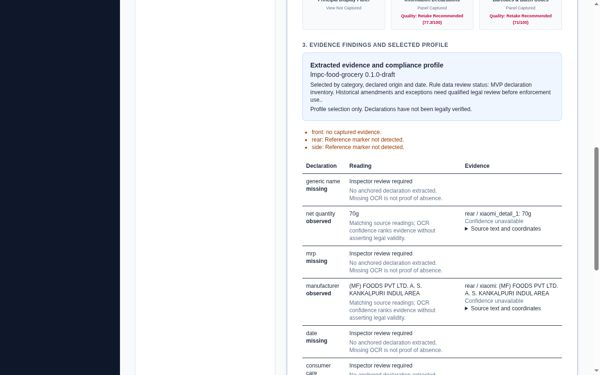

# Google-discovered packaging evaluation

Tested locally on 2026-11-06. This is a reproducible failure-and-repair case, not
an accuracy benchmark or a legal compliance assessment.

## Inputs and attribution

Google Images query: [parle g biscuits back pack label](https://www.google.com/search?udm=2&q=parle+g+biscuits+back+pack+label).
The result identified [Parle G Gluco Biscuits, Gharstuff](https://gharstuff.com/product/parle-g-gluco-biscuits/).
The exact Google-cached JPEGs are retained with URLs, dimensions and SHA-256 hashes
in [the source manifest](../evaluation/public-image-sources.json).

- [Rear wrapper, 596 × 514](../evaluation/fixtures/parle-g-rear.jpg).
- [Nutrition/ingredients detail, 529 × 578](../evaluation/fixtures/parle-g-nutrition-detail.jpg).

Images belong to their respective owners. They are attributed test fixtures, not
project artwork or an independently collected dataset. The nutrition detail is
uploaded in the API's side slot for transport testing; it is not an independent
side photograph. No front image or physical ArUco marker was supplied. Domestic
origin and the profile date were test inputs, not inferred from these images.

Visual inspection of the rear image shows `NET WEIGHT: 70g`. The price area shows
`MRP RS.` without a readable numeric amount. The nutrition table states quantities
per 100 g; those numbers must not become net quantity. The image has several
manufacturer/packer entries and tiny text, so these names require review.

## What failed and what changed

The [initial result](../evaluation/public-image-initial-result.json) completed the
HTTP pipeline but missed every declaration. Its lifecycle checks passed, including
replacement and deletion invalidation. It took 288.89 seconds including a second
local analysis after restoring the deleted image.

Three failures were traced to specific behavior:

1. A tiny wrapper pattern decoded as an ArUco marker. Analysis refused its scale,
   but capture still displayed a preliminary scale. The detector now rejects
   candidates below 40 pixels per edge and chooses the largest detected candidate.
2. CSV quote handling treated literal OCR quotes as TSV syntax and swallowed later
   rows. Tesseract TSV now uses literal quotes; word boxes and row boundaries survive.
3. Whole-page Xiaomi transcription missed the small quantity. Manufacturer names
   on the line immediately after their label were also missed. Extraction now
   handles immediate manufacturer continuation without inventing spatial boxes.
   A bounded local Xiaomi detail scan covers up to four overlapping quadrants when
   a declaration panel has no extracted net quantity. It stops on an anchored
   quantity and records original-image crop coordinates in the transcript.

Regression tests cover each code change. The real-image runner asserts `70g`, not
just an HTTP 200, and rejects the nutrition panel's per-100g value as net quantity.

## Corrected result

The [final real HTTP result](../evaluation/public-image-result.json) passed in
185.45 seconds with the pinned local Xiaomi checkpoint and Tesseract. Net quantity
was `observed: 70g`. The detail scan read the upper-left region first, then recovered
`NET WEIGHT: 70g` in original-image region `[238, 0, 596, 308]` and stopped. Both
original file hashes survived upload. Both views remained uncalibrated and every
physical-height value stayed null. The dated domestic draft profile was selected,
the outcome stayed `Manual Review Required`, and GET returned the saved analysis.

Generic name, MRP, date, consumer care and origin remained missing. Manufacturer
was observed from generated text but contains transcription errors, including
`(MF) FOODS` where the photo appears to read `(HP)-CF FOODS`. Treat the complete
name/address as unverified. This repair establishes recovery of the visible quantity,
not correctness of every extracted declaration.

The [one authorized Jev batch](../evaluation/public-image-jev-result.json) returned
valid suggestions for quantity and manufacturer, using 783 input and 68 output
tokens. It selected the `70g` source candidate with model confidence 0.96. It also
selected the imperfect manufacturer reading with confidence 0.94, demonstrating
why model confidence cannot substitute for visual verification. At $0.042 per
million input tokens and free output, this batch cost an estimated $0.000032886.
Combined with the earlier synthetic batch, estimated paid validation usage is
$0.000164934. These are pricing estimates, not measured account balances. No retries
or other paid requests were made.

## Reproduce

Start the backend with the optional Xiaomi runtime installed, cached checkpoint,
and Tesseract English data. Keep the server's TypeSafe key unset for local OCR.

```bash
PYTHONPATH=backend OMP_NUM_THREADS=4 HF_HUB_OFFLINE=1 backend/.venv/bin/uvicorn app.main:app --host 127.0.0.1 --port 8000
backend/.venv/bin/python evaluation/public_image_flow.py --keep-analysis
```

Remove `HF_HUB_OFFLINE=1` for the initial model download. `--keep-analysis` retains
the analyzed record for browser review; omit it to verify retake and removal
invalidation instead. Each run creates a new inspection. The runner verifies image
hashes, performs real JPEG upload and local inference, selects a draft dated
profile, checks the manual-review outcome and reads the saved analysis back.
It sets `use_jev=false` explicitly.

For the separately authorized paid check, provide the key through a server-side
secret manager and run one saved-analysis batch:

```bash
PYTHONPATH=backend backend/.venv/bin/python evaluation/jev_review.py
```

That script makes at most one Jev request and does not rerun OCR or retry failures.
It saves provider usage and recommendations separately from the original analysis.

## Browser evidence

The browser file input accepted the JPEG. Capture showed low-resolution and glare
warnings, enabled Next after a successful upload, and disabled Next after retake.
After the detector fix, uploading the same image showed calibration unavailable
instead of a preliminary scale. The front slot was used solely to test the upload
control with the rear fixture; it is not claimed as a genuine front capture.

Direct report navigation initially remained on the client Suspense fallback.
The report route now resolves the inspection ID from Next.js server search params
and passes it to the interactive client component. The report header also uses
extracted quantity/price when analysis exists; operator/default metadata can no
longer contradict the evidence with `100 g` and `₹50.00`.



The final production build was served with `next start`. Direct navigation to
`/reports?id=INS-2026-F1215202` rendered the saved evidence. Browser assertions
confirmed `Extracted net quantity: 70g`, `Extracted MRP: Unverified`, the detail
provider provenance, the manual-review outcome, no `₹50.00` default and no stuck
loading fallback. Jev was tested separately over the saved fields, so the original
local report correctly shows it disabled.



## Limits

Two related catalog images cannot establish field accuracy across products or
languages. Crops reuse pixels, so they are not independent confirmation. Xiaomi
transcription can still contain incorrect small text. Confidence and coordinates
remain unavailable for generated text. MRP, date and other unreadable declarations
must remain missing or in conflict; no value is filled from catalog text, account
metadata or the test's product name. Missing extraction is not proof that a legally
required declaration is absent. No physical text height or legal verdict is claimed.
